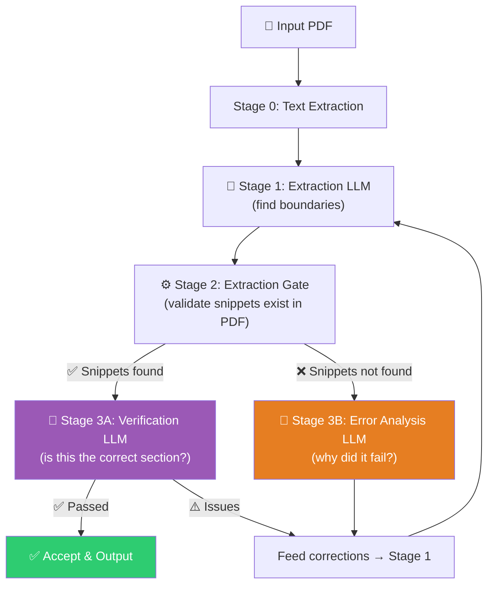

# Project Scribe

*Note: This repository currently serves as an experimental benchmarking pipeline. It is a research testbed designed to evaluate and perfect document extraction architectures before deploying them into a much larger, future system.*

Project Scribe is an intelligent, self-correcting pipeline designed to automatically locate, extract, and dissect the "Related Work" sections from academic research paper PDFs.

Finding and extracting specific semantic sections from academic literature requires navigating complex multi-column layouts, diverse formatting, and occasionally non-existent section headers (where the introduction serves as the related work). Scribe solves this using a multi-stage Large Language Model (LLM) architecture backed by deterministic PDF text-grounding.

## Architecture (v4 Iterative Pipeline)

Scribe has recently transitioned from a single-shot extraction approach (v2) to a robust **iterative and self-correcting loop (v4)**.



1. **Stage 1 (Extractor)**: Reads the PDF text in sliding windows and asks the LLM to identify the start and end snippets of the Related Work section (or fallback to the Introduction if no explicitly labeled section exists).
2. **Stage 2 (Extraction Gate)**: A deterministic set of functions that map the LLM's chosen text snippets back to actual bounding boxes and text blocks in the PDF. This prevents LLM hallucinations from propagating.
3. **Stage 3 (Verification / Error Analysis)**: 
   - If the gate extracts the text successfully, the **Verifier LLM** reviews it to ensure no adjacent sections leaked in and that it's definitively the correct content.
   - If the gate fails (snippets hallucinated or malformed), the **Error Analyzer LLM** determines why.
   - Any failures or feedback loops are injected as a "correction context" into a new Stage 1 attempt. This can iterate up to 3 times.

## Setup Requirements

### Prerequisites
- Python 3.10+
- An API Key from [OpenRouter](https://openrouter.ai/) for the LLM backend (currently configured to use Anthropic's Claude 3 Opus).

### Dependencies
Install the required packages. A standard `requirements.txt` equivalent includes:
```bash
pip install pymupdf openai httpx python-dotenv
```

### Environment Variables
Create a `.env` file in the root directory and add your OpenRouter API key:
```env
OPENROUTER_API_KEY=your_api_key_here
```

## Usage

To run the pipeline on a single PDF paper, use the `process_paper_v4.py` script:

```bash
python process_paper_v4.py path/to/your/research_paper.pdf
```

### Outputs
Upon a successful extraction, the outputs will be generated in the `./outputs/` directory:

- `related_work_only.pdf`: A newly generated PDF containing *only* the related work section.
- `paper_without_related.pdf`: A redacted version of the original PDF with the related work section removed/white-boxed out.
- `related_work.txt`: The raw extracted text of the section.
- `related_work_raw.json`: The raw boundaries (pages and text snippets) determined by the LLM.
- `pipeline_log.json`: A full telemetry log of the iterations, LLM confidence scores, and correction contexts used during the run.

## Testing Suite

Scribe includes a rigorous testing harness designed to evaluate against ground truth labels. The `test_data/` directory contains sample PDFs alongside JSON files that dictate the exact start and end snippets.

You can run the testing suite using:
```bash
python test.py
```
*Note: Currently `test.py` defaults to testing the older `process_paper_v2.py` pipeline. Support for benchmarking v4 across the dataset is an actively incoming feature.*

## Repository Structure

- `pipeline/`: The core v4 modular pipeline package.
  - `extractor.py`: PDF parsing and Stage 1 inference.
  - `gate.py`: PyMuPDF geometry and snippet searching logic.
  - `verifier.py` & `error_analyzer.py`: Stage 3 feedback LLMs.
  - `orchestrator.py`: The routing mechanism that dictates max retries and triggers the logic loop.
  - `schemas.py`: Typed data classes for state bridging.
  - `prompts.py`: Centralized Prompt Engineering instruction sets.
- `process_paper_v4.py`: Command Line Interface entry point for the newest architecture.
- `process_paper_v2.py` / `v3.py`: Legacy single-shot scripts retained for benchmarking context.
- `test.py` / `test_data/`: Ground Truth evaluation toolkit.
